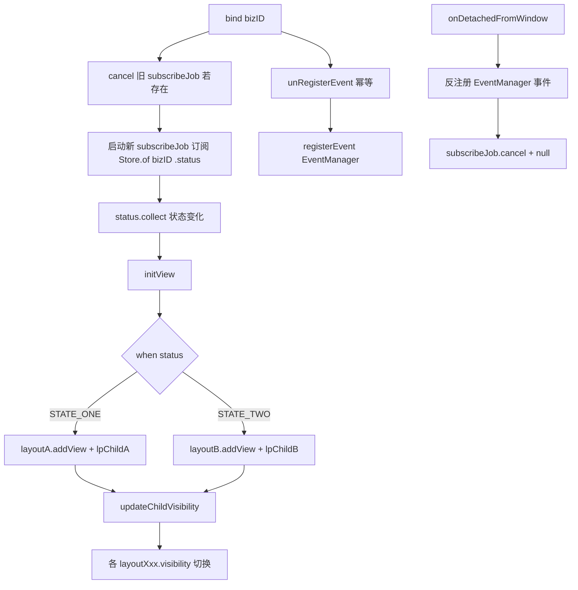

## Android View 类开发模版

本模版适用于所有 UIKit View 开发模版，  包含 **视图初始化、数据订阅、跨 View 事件通信** 等场景。

> **【最高优先级 · 业务闭环原则】**
> 每个 View 必须在**自身所属的功能目录内完成业务闭环**，**严禁对外暴露任何回调接口**（`interface Listener`、`OnXxxListener`、lambda 回调 setter、`delegate` 等一律禁止）。
> - 跨 View、跨阶段（如准备页 → 直播中）的通信，一律通过 `EventManager` 事件总线上抛，由**同模块内**负责编排的上层 View / 容器承接处理。
> - 打开面板、弹窗等动作，由承接事件的模块内组件通过 `RouterManager` 等模块内能力完成，不得把业务事件抛给外部宿主。
> - View 的构造方法不接收任何回调参数；对外通信只有"向事件总线发事件"这一条出口。

---

## 一、目录结构约定
### 一个 View 所有交互事件不涉及弹出新对话框、弹出新面板、弹出新页面时：
**适用判定**（全部满足时使用单 View）：
- 一个 View 所有交互事件不涉及弹出新对话框、弹出新面板、弹出新页面时。
- 所有交互逻辑（点击、手势）的总行数可控，单一文件即可内聚完成业务闭环。

必须遵守的规则：
- 所有UI显示逻辑都在此类文件中完成业务闭环。
- 所有点击事件逻辑在此类中完成闭环。
- 满足上述条件时**不需要引入 Store / State**，UI 状态直接用 View 的 `private` 属性持有并在事件回调中更新。

示例如下：
```
xxx/
└── XxxView.kt   
```

### 一个 View 的交互事件有弹出新对话框、弹出新面板、弹出新页面时：
**适用判定**（满足任一条件即应拆分）：
- 一个 View 的交互事件有弹出新对话框、弹出新面板、弹出新页面时。
- 界面存在 2 个以上**可独立描述职责**的功能区块（如"顶部信息区 / 视频区 / 底部操作区"），每个区块有自己的交互闭环；
- 一个 `switch`/多处 `if-else` 在切换截然不同的 UI 区块；
- 某个区块有独立的子状态机或独立的数据订阅需求，与其他区块耦合度低。

拆分只看职责，不看文件行数。不因为文件长就把同一职责切开，也不因为文件短就把两个职责塞在一起；只被一个类型使用的绘制辅助、Drawable、Adapter 与私有子控件，放在使用方同一文件内。

必须遵守的规则：
- XxxView 负责 内部子View 的布局，子View 的业务逻辑在子 View 文件中完成业务闭环。
- 子View 可以访问 XxxView 的状态，但是不能修改 XxxView 的状态，并且 XxxView 不应该访问子View 的状态。
- 子View 如果需要通知 XxxView 修改状态，需要使用 接口回调 实现。如果垮目录需要使用 EventManager实现。

示例如下：
```
xxx/
├── XxxView.kt                 // 主 View
├── XxxStore.kt                // （可选：提供 api 调用，UI 状态定义或者更新）- 数据源（StateFlow）
├── subview1/              
│   └── SubView1.kt
├── subview2/
│   └── SubView2.kt
└── ...
```

### 资源文件
必须遵守的规则：
- 资源文件需要使用 livekit_ 前缀
- 命名为单词间用下划线连接
- 字符串资源必须在 strings.xml 定义并作国际化，不能硬编码在类中或者xml中。
- 颜色资源需要将交互稿中的颜色定义在 [ColorTokens.kt] 中定义，通过 R.color.textColorPrimary 方式引用，不应该硬编码到代码中。

示例如下：
```
res
├── layout/              
│   └── livekit_xxx_view.kt         
├── values/              
│   └── strings.xml
└── values-zh         
    └── strings.xml
```

---

## 二、类骨架模板
必须遵守的规则：
- init 代码块中 View 布局使用 xml 的方式，不要用代码创建一大堆 View。
- View 的构造方法中不要传入任何参数（**尤其禁止传入任何回调 / Listener**）。需要传入业务参数，可通过 bind() 代码块实现。
- View **禁止对外暴露 public 回调接口 / Listener / lambda setter / delegate**；确需暴露的 public 方法仅限"接收上层下发的数据或指令"（如 `updateXxx(data)`），并定义在 onDetachedFromWindow 和 XXXLayoutParams 代码块之间。
- 容器类 并且需要动态调整 子View 布局的情况下，继承自 ConstraintLayout 实现
- 容器类 子View 位置相对固定的情况下，继承自 FrameLayout 实现
- 弹窗类 面板视图，继承自[AtomicPopover.kt] 实现
- 以下所有可选的代码块 如果不是必要的就不要添加，
- View 类文件从上到下布局如下：
```
package 语句代码块
    ｜
import 语句代码块
    ｜
枚举 等类型定义 代码块 （可选）
    ｜
XxxView 类定义 代码块
    ｜
companion object {}  代码块 （可选，如果需要定义静态成员变量或者常量就添加）
    ｜
成员变量定义 代码块 （可选，如果需要定义成员变量就添加）
    ｜
init {} 代码块
    ｜
bind {} 代码块  （可选，如果需要绑定数据则一定要实现）
    ｜
override fun onDetachedFromWindow() 代码块  （可选，如果绑定了数据监听或者事件注册，需要在 onDetachedFromWindow 中解绑）
    ｜
object XXXLayoutParams {} 代码块 （可选，如果需要code 确定 子view 视图再添加）
    ｜
other 代码块（可选）
    |
} 类文件结束代码块
```

示例如下：
```kotlin
/**
package com.example.xxxview

import android.content.Context
import android.util.AttributeSet
import android.view.LayoutInflater
import android.widget.FrameLayout
import androidx.constraintlayout.widget.ConstraintLayout
import com.example.R
import com.example.xxxview.XxxView.XxxLayoutParams.lpChildA
import com.example.xxxview.XxxView.XxxLayoutParams.lpChildB
import com.trtc.uikit.livekit.common.basic.event.EventManager
import com.trtc.uikit.livekit.common.basic.event.INotification
import com.trtc.uikit.livekit.common.basic.ScreenUtil
import kotlinx.coroutines.CoroutineScope
import kotlinx.coroutines.Dispatchers
import kotlinx.coroutines.Job
import kotlinx.coroutines.launch

enum class XxxStatus {
    STATE_ONE,
    STATE_TWO,
}

class XxxView @JvmOverloads constructor(
    context: Context,
    attrs: AttributeSet? = null,
    defStyleAttr: Int = 0,
) : FrameLayout(context, attrs, defStyleAttr) {

    companion object {
        const val EVENT_KEY_XXX_VIEW = "XxxView"
        const val EVENT_SUB_KEY_ON_CLOSE = "onClose"
        const val EVENT_PARAMS_KEY_BIZ_ID = "bizID"
    }

    private val layoutA: FrameLayout
    private val layoutB: ConstraintLayout

    private var bizID: String = ""
    private var subscribeJob: Job? = null

    init {
        LayoutInflater.from(context).inflate(R.layout.livekit_xxx_view, this, true)
        layoutA = findViewById(R.id.fl_a)
        layoutB = findViewById(R.id.fl_b)
    }

    fun bind(bizID: String) {
        this.bizID = bizID
        subscribeJob?.cancel()
        subscribeJob = CoroutineScope(Dispatchers.Main).launch {
            launch {
                XxxStore.of(bizID).status.collect { initView() }
            }
            launch {
                XxxStore.of(bizID).otherData.collect { data -> handleOtherData(data) }
            }
        }
    }

    override fun onDetachedFromWindow() {
        super.onDetachedFromWindow()
        EventManager.instance.unRegisterEvent(
            EVENT_KEY_XXX_VIEW,
            EVENT_SUB_KEY_ON_CLOSE,
            closeEventNotification,
        )
        subscribeJob?.cancel()
        subscribeJob = null
    }

    object XxxLayoutParams {
        val lpChildA = FrameLayout.LayoutParams(
            FrameLayout.LayoutParams.WRAP_CONTENT,
            FrameLayout.LayoutParams.WRAP_CONTENT,
        )

        val lpChildB = ConstraintLayout.LayoutParams(
            ConstraintLayout.LayoutParams.WRAP_CONTENT,
            ConstraintLayout.LayoutParams.WRAP_CONTENT,
        ).apply {
            topToTop = ConstraintLayout.LayoutParams.PARENT_ID
            endToEnd = ConstraintLayout.LayoutParams.PARENT_ID
            topMargin = ScreenUtil.dip2px(56f)
            marginEnd = ScreenUtil.dip2px(20f)
        }
    }

    private fun initView() {
        when (XxxStore.status.value) {
            XxxStatus.STATE_ONE -> {
                layoutA.addView(ChildAView(context), lpChildA)
            }
            XxxStatus.STATE_TWO -> {
                layoutB.addView(ChildBView(context), lpChildB)
            }
        }
        updateChildVisibility()
    }

    private fun updateChildVisibility() {
        when (XxxStore.status.value) {
            XxxStatus.STATE_ONE -> {
                layoutA.visibility = VISIBLE
                layoutB.visibility = GONE
            }
            XxxStatus.STATE_TWO -> {
                layoutA.visibility = GONE
                layoutB.visibility = VISIBLE
            }
        }
    }

    private fun handleOtherData(data: Any) {
    }
}
**/
```

---

## 三、数据订阅与生命周期
必须遵守的规则：
- 每个 View 实例在**每次 attach 前后必须调用一次 `bind(bizID)`**（对方式二在 `findViewById` 之后调用；对方式一在 `addView` 之前调用）。
- View **detach 后 subscribeJob 已被取消、事件总线已反注册**，若后续需再次使用该 View 实例（如 ViewPager2 复用、Fragment show/hide），业务方**必须重新调用
  `bind()`** 恢复订阅与事件监听。
  -`bind()` 之后**必须保证 View 会经历完整的 attach → detach 生命周期**，否则事件总线中的注册无法通过 `onDetachedFromWindow` 释放，会造成事件回调泄漏。


### 使用场景与时序差异
`bind(bizID)` 之后才能拿到可观察的数据源（Store 需要用 `bizID` 定位）。View 有两种典型使用方式，二者 `bind()` 与 `onAttachedToWindow()` 的先后顺序**完全相反**：

| 使用方式 | 步骤 | 时序 |
|---|---|---|
| **方式一：代码动态创建** | ① `XxxView(context)` → ② `view.bind(bizID)` → ③ `parent.addView(view)` | `bind()` **早于** `onAttachedToWindow()` |
| **方式二：XML 声明式** | ① XML 中 `<XxxView />` → ② `findViewById(...)` → ③ `view.bind(bizID)` | `bind()` **晚于** `onAttachedToWindow()` |

### 设计方案：bind 中初始化、detach 中清理
- **`bind(bizID)`**：赋值 `bizID` → `subscribeJob?.cancel()` 取消旧订阅 → 启动新 `subscribeJob` 订阅 Store → 先 `unRegisterEvent` 再 `registerEvent`，保证事件总线幂等注册。
- **`onAttachedToWindow()`**：一般无需 override；如果没有 attach 相关的原生 View 操作，可以省略。
- **`onDetachedFromWindow()`**：反注册事件总线 + `subscribeJob.cancel()` + 置 `null` + `onXxxListener = null`。

### 骨架示例

```kotlin
fun bind(bizID: String) {
    this.bizID = bizID
    subscribeJob?.cancel()
    subscribeJob = CoroutineScope(Dispatchers.Main).launch {
        launch {
            XxxStore.of(bizID).status.collect { initView() }
        }
        launch {
            XxxStore.of(bizID).otherData.collect { data -> handleOtherData(data) }
        }
    }
}

override fun onDetachedFromWindow() {
    super.onDetachedFromWindow()
    subscribeJob?.cancel()
    subscribeJob = null
}
```

### 两种使用方式的执行时序

**方式一：代码动态创建**
```
XxxView(context)
    ↓
view.bind(bizID)              → 启动 subscribeJob + 注册 EventManager 事件 ✅（此时未 attach，StateFlow 与事件总线均可正常工作）
    ↓
parent.addView(view)
    ↓
onAttachedToWindow()          → 无需业务动作
    ↓
... 使用中 ...
    ↓
parent.removeView(view)
    ↓
onDetachedFromWindow()        → 反注册事件 + subscribeJob.cancel() ✅
```

**方式二：XML 声明式**
```
XML inflate 完成
    ↓
onAttachedToWindow()          → 无需业务动作（bizID 未就绪，订阅与事件注册均由 bind 触发）
    ↓
findViewById → view.bind(bizID) → 启动 subscribeJob + 注册 EventManager 事件 ✅
    ↓
... 使用中 ...
    ↓
Activity/Fragment destroy
    ↓
onDetachedFromWindow()        → 反注册事件 + subscribeJob.cancel() ✅
```

### 状态驱动流程图



### 关键要点

- **`bind()` 是唯一业务初始化入口**：数据订阅与事件总线注册全部在此完成，`onAttachedToWindow` 可省略业务代码。
- **`bind()` 中先 cancel 再启动订阅**：`subscribeJob?.cancel()` 保证重复调用 `bind()` 或切换 `bizID` 时不会出现多个订阅并存。
- **`bind()` 中先 unRegister 再 register 事件**：`EventManager` 是全局单例，重复 `register` 同一 `INotification` 会导致回调被触发多次；先反注册保证幂等。
- **`onDetachedFromWindow` 必须 cancel subscribeJob 并反注册事件**：协程和事件总线均持有对 View 的隐式引用，不清理会导致内存泄漏。
- **detach 后需再次使用 View → 必须重新 `bind()`**：detach 时订阅已取消、事件已反注册，且不会随 attach 自动恢复；这是本方案对业务方的显式约束。
- **`bind()` 之后必须经历完整的 attach → detach**：否则事件总线里的注册无法通过 `onDetachedFromWindow` 释放，造成事件回调泄漏。若确需在未 attach 场景下丢弃 View，业务方需自行调用清理方法。
- **`bizID` 在 detach 时不清空**：保留 `bizID` 作为业务凭证仅用于事件过滤等场景。

---

## 四、内存泄漏防护
必须遵守的规则：
- **禁止对外持有宿主回调 / Listener**：跨 View 通信一律走 `EventManager`，事件回调（`INotification`）随 `onDetachedFromWindow` 反注册，不得让 View 长期持有外部对象引用。
- **不要**将任何回调 / `INotification` 塞入 `Store` / 单例，否则生命周期与 View 脱钩，无法及时释放。
- **`subscribeJob` 必须在 detach 时 cancel**，避免协程持有 View 引用泄漏。
- **多实例场景（如 ViewPager2 中）**：事件 params 里带上业务唯一 ID（如 `bizID`），`INotification` 中比对后再触发处理，避免误触发相邻实例。


---

## 五、快速开发 Checklist
- [ ] 类声明加 `@SuppressLint("ViewConstructor")` + `@JvmOverloads`，构造参数末尾放业务 ID。
- [ ] StateFlow 订阅统一放在 `bind 代码块`，`subscribeJob` 记得 cancel。
- [ ] 事件常量放 `companion object`，命名遵循 `EVENT_KEY_ / EVENT_SUB_KEY_ / EVENT_PARAMS_KEY_`。
- [ ] `INotification` 中按 params 里的业务 ID 过滤，避免多实例误触发。
- [ ] **禁止对外回调接口**：不定义 `interface Listener` / `OnXxxListener` / lambda setter；跨 View、跨阶段通信统一通过 `EventManager` 上抛并在模块内承接。
- [ ] `LayoutParams` 与子 View 构建函数抽到 `object XXXLayoutParams`，主类保持简洁。
- [ ] 布局根节点若无约束需求用 `FrameLayout`，需要按边约束用 `ConstraintLayout`（多控件对齐场景）。
- [ ] 代码或资源文件如无特殊说明不要添加注释信息。
